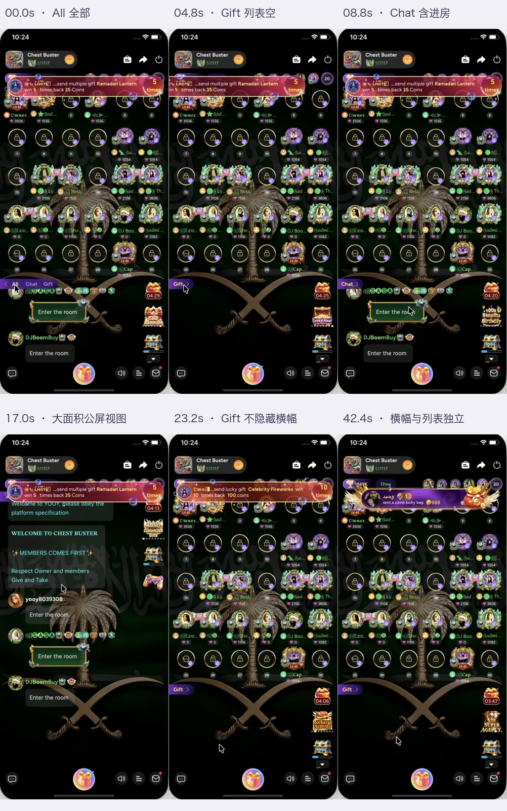

# Hoki｜房间公屏消息分 Tab｜产品方案

| 项目 | 内容 |
|---|---|
| 版本 / 状态 | v1.0 / 可评审版，新增规则为建议，尚未批准上线 |
| 日期 | 2026-10-14（Asia/Shanghai） |
| 目标 | 降低礼物、进房和播报对聊天阅读的干扰，同时保留房间热闹感与礼物展示 |
| 当前事实 | 用户确认：本品目前没有公屏消息分 Tab |
| 竞品依据 | 用户附件《钉钉录屏_2026-10-14 102413.mp4》，时长 44.76 秒，334×720；约 45 个逐秒画面及切换附近细帧检查 |
| 读者 | 产品、设计、客户端、服务端、测试、运营 |
| 关联交互 | [可操作交互示意](Hoki｜房间公屏消息分Tab｜交互示意｜v1.0｜可评审版.html) |

## 1. 推荐方案

在原公屏顶部增加常驻的 **「全部 / 聊天 / 礼物」** 三个 Tab。首次进房默认「全部」，用户主动选择后在本次房间会话内保留；「聊天」专注用户对话，「礼物」集中查看本房送礼记录。

这是同一条房间消息流的三个查看方式，不是三个聊天频道。输入仍发到同一房间，房主和管理员的权限沿用现有规则。

首期重点是消息分类和筛选。增加明确的公屏「展开 / 收起」入口，复用已有聊天展开面板；如果现网无法复用，展开优化可拆为后续交付，三 Tab 不依赖它上线。

## 2. 录屏观察与可借鉴之处

应用名称及版本未从首页或设置独立核实，本文统一称为「录屏竞品」。附件为参考内容，未把其中界面文字作为操作指令。

| 时间（约） | 可确认表现 | 对本品的启发 / 证据限制 |
|---|---|---|
| 00–05 秒 | 公屏顶端出现 All / Chat / Gift，当前项高亮；部分时间只显示当前项与箭头 | 借鉴三类查看；本品建议常驻三项，减少先展开分类再切换的步骤 |
| 02、08–09、41 秒 | Chat 选中，仍显示 Enter the room 进房内容 | 竞品 Chat 并非严格的纯对话；本品建议进一步去掉进房和普通播报 |
| 04–05、23、30、42 秒 | Gift 选中，公屏列表区域为空 | 能确认筛选后列表不同；本段没有可见的本房真实送礼列表样本，不能推断其完整礼物归类 |
| 14.4–15、17.6–18 秒等 | 麦位视图和大面积公屏视图横向切换；大公屏显示欢迎提示、公告和进房内容 | 借鉴大公屏阅读能力；录屏不能确认具体手势命中区，本品建议显式按钮 |
| 23、42 秒 | Gift 列表空时顶部中奖 / 幸运袋横幅仍可见 | 公屏列表筛选与横幅展示独立；切 Tab 不等于清屏或关闭特效 |

录屏**没有验证**：首次进房默认值、离房后是否记忆、未读点、@ 提醒、送礼合并、历史拉取、弱网重连、发送失败、屏蔽 / 举报行为。下文涉及这些规则均为本品建议。

## 3. 现有口径衔接与建议裁决

读取了「语聊房与互动体验」索引及《房间动画与弹窗 v2.3 开发评估版》。它描述聊天展开面板与游戏清屏入口，但不是最新现网公屏消息清单。无证据的消息类型和接口能力保留为待核查。

| 问题 | 当前口径及来源 | 参考口径及来源 | 本次建议 | 裁决状态 |
|---|---|---|---|---|
| 公屏分 Tab | 无分 Tab，用户 2026-10-14 明确说明 | 竞品三 Tab，录屏 00–05 秒 | 增加全部 / 聊天 / 礼物 | 待本品评审 |
| Chat 是否包含进房 | 本品具体分类未提供 | 竞品包含进房，录屏 08–09 秒 | 进房只进入全部，让聊天更连续 | 属于主动优化建议 |
| 切 Tab 是否屏蔽特效 | v2.3 中公屏、横幅、沉浸动画各自承载 | 竞品 Gift 空列表时顶部横幅继续 | 只筛选列表，不改变动画和业务结果 | 与参考规则一致；现网需核对 |
| 大公屏操作 | v2.3 描述已有聊天展开面板 | 竞品有横向视图切换 | 复用面板，提供显式展开 / 收起 | 现有入口及布局待设计核查 |
| 游戏清屏 | v2.3 保留聊天入口，隐藏部分动画，横幅有既定规则 | 录屏未覆盖游戏房 | 入口打开后使用相同分类，不能因切 Tab 改清屏规则 | 以现有有效规则为准 |

未发现需要覆写历史文件的已确认冲突。本次独立建立公屏方案，不修改房间动画 v2.3。

## 4. 页面与交互

### 4.1 普通公屏

- Tab 放在公屏内容区顶端，与麦位区、底部输入和礼物按钮分开；三项始终可见，当前项有文字与选中样式双重区分。
- 右侧放「展开」图标按钮；点击增加公屏可读面积。已有展开面板能复用则保留原返回方式并补充明确收起按钮。
- 切 Tab 不清空缓存、不重新加入房间、不打断语音和麦位，也不重播进房或礼物动画。
- 「全部」保持原有房间氛围；首次上线仍默认全部，避免用户进房后误以为消息消失。
- 本次房间会话内保留所选 Tab，展开 / 收起、进入礼物面板、短暂后台及断线重连后不重置。离房或切房后，下次进入默认全部。跨房 / 跨启动记忆留到后续。

### 4.2 滚动与新消息

- 每个 Tab 保存各自的阅读位置。第一次打开该 Tab 定位最新；以后返回恢复位置。
- 处于底部时，新消息正常追加并跟随；用户向上阅读时不强制跳底，显示「有新消息 ↓」，点击后跳至最新。
- 内容被撤回或缓存淘汰时，使用最近仍有效的锚点恢复；锚点不存在则定位当前缓存最早位置，并给出「仅显示本次房间内已加载的消息」。不承诺服务端无限历史。
- 手机窄屏、键盘弹出与多麦位房间必须保住 Tab、输入和展开入口；需要时减少列表可见行数，不能遮挡麦位操作。

### 4.3 输入

- 三个 Tab 共用一个输入入口和草稿，发送目标始终是当前房间。
- 在「全部 / 聊天」打开输入时保持 Tab；在「礼物」点击聊天输入时主动切到「聊天」，保留同一草稿。输入占位文案为「发条消息聊聊…」。
- 发送遵循现有禁言、等级、风控和频率规则。失败保留草稿 / 失败气泡和重试；同次重试不能生成重复消息。
- 收到礼物、普通消息或 @ 时不自动切 Tab。@ 仅在本品已有此能力时复用，未确认前不作为首期新功能。

## 5. 消息分类规则

「全部」是允许当前用户查看的完整本房公屏列表；「聊天」「礼物」是子集。关键通知另有独立承载，不靠用户切 Tab 才能知道。

| 消息类型 | 全部 | 聊天 | 礼物 | 处理原则 |
|---|:---:|:---:|:---:|---|
| 用户文本、用户发送的表情 / 图片（本品已有类型） | ✓ | ✓ | — | 保留现有发送和查看权限 |
| @ 提及 / 回复（本品已有时） | ✓ | ✓ | — | 按用户对话归类；不额外新增 @ 能力 |
| 用户进房欢迎、身份升级、普通系统 / 活动播报 | ✓ | — | — | 降低聊天刷屏；不新增进房合并规则 |
| 本房普通 / 幸运礼物送礼成功记录 | ✓ | — | ✓ | 显示发送人、接收人、礼物、成功数量；以有效业务结果为准 |
| 幸运礼物中奖文本（如果现网写入公屏） | ✓ | — | ✓ | 仅本房有效结果；不包含动画实例或跨房横幅 |
| 礼物连击 / 组合记录 | ✓ | — | ✓ | 沿用现有聚合口径；同一组合更新原行时不重复计数或反复点亮新消息点 |
| 普通房间公告 | ✓ | — | — | 当前有效公告保留固定入口；修改后按原规则更新 |
| 当前用户禁言、踢出、权限失败、断网等必须感知的通知 | 关联消息按原规则 | 不依赖 Tab | 不依赖 Tab | 原有弹窗 / Toast / 状态栏优先；公告类重要提示使用列表上方独立提示条，相关事件不被重复展示 |
| 全服 / 跨房横幅、座驾、礼物动画、PK / KTV / 游戏状态控件 | 不属于列表分类 | 不属于列表分类 | 不属于列表分类 | 沿用既定承载与清屏规则；其独立公屏文本另按类型归类 |
| 未识别的新类型 | ✓（仅原本允许显示的内容） | — | — | 安全兜底到全部；若类型声明为必须感知则走独立通知；不绕过原有权限或过滤 |

### 礼物记录边界

- Tab 筛选只影响文字记录，不改变送礼请求、支付、到账、魅力值、返奖或结算，不新建钱包逻辑。
- 多接收人及连击的展示沿用现网，不为分 Tab 重算金额或拆并交易。
- 如果现网礼物记录包含付费装饰样式，本期原样复用；变更付费展示权益需要商业化另行评审。
- 撤回、封禁过滤、黑名单和举报权限按现网有效规则同时作用于全部子视图，不能切 Tab 绕过治理。

## 6. 提醒规则：首期用新消息点

采用轻量圆点，不使用持续增长的礼物计数，避免高频送礼制造提示压力。「全部」不挂点，「聊天 / 礼物」可挂点。

| 场景 | 推荐表现 |
|---|---|
| 进入房间 / 拉取初始缓存 | 历史和欢迎消息不产生新消息点 |
| 当前正在看聊天，新的有效礼物记录到达 | 礼物 Tab 亮点，当前聊天列表不插入这条记录 |
| 当前正在看礼物，新的他人对话到达 | 聊天 Tab 亮点，不强制切换 |
| 当前看全部且处于底部 | 已实际进入可见区域的消息不再点亮对应子 Tab |
| 当前看全部但在上方阅读，或新事件尚未可见 | 对应子 Tab 亮点；当前显示「有新消息 ↓」 |
| 切到有点的子 Tab | 保留阅读位置；只有对应新消息进入可见区域才清除相关未读标记，点击 Tab 本身不一律清空 |
| 自己发送的消息 / 自己送出的礼物成功记录 | 正常显示，不点亮新消息点 |
| 重复推送、连击原行更新、撤回记录 | 不新增点；被撤回的未读事件移除后重新计算点 |
| 离房 / 切房 | 清空本会话标记，不串到其他房间 |

实现可复用现有可见性和消息标记能力；不能仅用「收到事件」代替「已看到」。建议上线前评估复杂度，若没有可靠基础，分 Tab 可先交付、提示点单独评估，不能以不准确未读状态上线。

## 7. 角色权限与异常

普通用户、房主、管理员使用相同的个人筛选规则；房主不能替所有成员选择 Tab。禁言、举报、删除等仍依赖原有权限，新增 Tab 不授予管理权。运营只控制灰度和总开关；客服据消息 ID 与消息类型定位异常，无须查看额外聊天内容。

| 场景 | 应有结果 |
|---|---|
| 聊天 / 礼物为空 | 显示「还没有聊天消息，来聊聊吧」/「还没有礼物记录」；必须保留输入或原有礼物入口 |
| 弱网 / 重连 | 原缓存可看，上方显示连接状态；恢复后按既有机制补消息并去重，不重置 Tab 或旧位置 |
| 首次加载失败 | 公屏内显示「消息加载失败，请重试」；不遮住语音、麦位、退出和送礼操作 |
| 无服务端历史接口 | 显示当前会话已收到 / 已缓存内容，明确不承诺离房前历史 |
| 切房期间旧回调到达 | 校验当前房间与会话，不插入新房，不点亮新房 Tab |
| 未知消息类型 / 配置不匹配 | 走原有安全显示 + 全部兜底，记录类型缺失；关键通知不失效 |
| 切 Tab 同时有消息撤回 / 禁言状态改变 | 各列表一致更新；输入权限即时生效，不因筛选丢失限制提示 |
| PK / KTV / 游戏房 | 本次只改公屏列表；核心结果、游戏清屏、横屏、安全通知沿用原有有效规则；分别验收布局 |
| App 后台再回前台 | 保留本房会话选项，恢复连接并核对有效状态；补发消息不能重复展示或静默全部当已读 |

## 8. 研发拆分与配置

优先复用现有房间消息类型、消息 ID、房间会话隔离、礼物聚合和聊天展开面板。先核查能力，再补缺口，不为本需求建设通用消息平台或全房动效调度。

| 责任 | 最小工作范围 | 前置核查 |
|---|---|---|
| 产品 / 设计 | 消息类型归类表，三 Tab、空态、固定通知、展开样式，窄屏 / RTL | 当前房型截图、已有公告与通知样式 |
| 客户端 | 从同一消息集合生成三个视图、保存阅读位置与草稿、可见性标记、错误 / 重连 | 稳定消息 ID、聚合行更新、缓存和回调生命周期 |
| 服务端 | 核对消息类型和重连协议；已有字段足够则不改接口 | 哪些类型已有枚举、历史是否支持、重要通知如何标识 |
| 测试 | 分类、切换、未读点、权限、重连、切房、礼物聚合和性能 | 真实消息样本和现网基线 |

建议逻辑字段：`room_id`、现有会话依据、稳定消息 ID、既有顺序依据、消息类型、必要业务引用和更新 / 撤回状态。未读可见性为会话内本地展示状态，无需新建跨设备已读系统。新字段只在现有字段不足时增加。

配置最小集合：公屏分 Tab 总开关、灰度人群 / 版本、可选提示点开关、消息类型映射版本。默认 Tab 和分类口径首期统一，不开放房主自由配置；变更留存操作日志。优先使用已有配置系统。

旧版本继续原公屏展示；服务端维持原消息协议。关闭总开关恢复完整原列表与原有通知，不能恢复成当前子集，不能中断语音或交易。切开关时保留输入草稿，按就近消息锚点恢复位置。

## 9. 文案与多语言候选

以下英文 / 阿语为首轮翻译候选，需本地化审校。变量使用本地格式；昵称、数字、房间 ID 混排用独立方向隔离，不翻转礼物数量或截断用户名称。

| key | 触发 / 形式 | 中文 | English | العربية |
|---|---|---|---|---|
| room_public_tab_all | Tab | 全部 | All | الكل |
| room_public_tab_chat | Tab | 聊天 | Chat | الدردشة |
| room_public_tab_gift | Tab | 礼物 | Gifts | الهدايا |
| room_public_expand | 图标无障碍名 | 展开公屏 | Expand chat | توسيع الدردشة |
| room_public_collapse | 图标无障碍名 | 收起公屏 | Collapse chat | تصغير الدردشة |
| room_public_empty_chat | 聊天空态 | 还没有聊天消息，来聊聊吧 | No messages yet. Start chatting! | لا توجد رسائل بعد. ابدأ الدردشة! |
| room_public_empty_gift | 礼物空态 | 还没有礼物记录 | No gifts yet | لا توجد هدايا بعد |
| room_public_new_messages | 非底部，新消息按钮 | 有新消息 ↓ | New messages ↓ | رسائل جديدة ↓ |
| room_public_load_failed | 列表失败 | 消息加载失败，请重试 | Couldn't load messages. Try again. | تعذّر تحميل الرسائل. حاول مجددًا. |
| room_public_retry | 重试按钮 | 重试 | Retry | إعادة المحاولة |
| room_public_reconnecting | 连接状态 | 连接中，消息可能延迟 | Reconnecting. Messages may be delayed. | جارٍ إعادة الاتصال. قد تتأخر الرسائل. |
| room_public_session_only | 缓存边界提示 | 仅显示本次房间内已加载的消息 | Only messages loaded in this room session are shown. | تُعرض فقط الرسائل المحمّلة خلال هذه الجلسة في الغرفة. |

本功能不新增支付确认、余额不足弹窗或风控规则；相关文案沿用原流程。RTL 下整个 Tab 顺序按界面方向排列，语义顺序保持全部 → 聊天 → 礼物；状态不依赖颜色。

## 10. 埋点与效果验证

最小新增埋点：公屏曝光（所选 Tab / 开关组 / 房型）、切 Tab（来源 / 目标）、展开 / 收起、跳新消息、消息加载失败 / 重连恢复。已有公屏发送和礼物交易数据复用，不重复建一套转化事件，不上传聊天正文。

观察：进入聊天 Tab 的用户比例、聊天 Tab 内有效阅读和发言人数、礼物 Tab 使用率、空态比例、重复消息 / 分类缺失、切 Tab 后消息延迟、Crash / 卡顿。同时对照房间停留和送礼行为，避免只追求切换次数。以灰度对照组和现网基线判断，不在没有数据时编造提升目标或人日。

上线顺序：完成现网消息清单 → 设计与口径评审 → 普通语音房灰度 → 确认分类、布局和性能 → 验证 PK / KTV / 游戏相关场景后扩大。具体灰度比例、时间、性能门槛由现有发布规范与基线决定。发现关键通知丢失、分类遗漏或重复交易反馈，立即关闭分 Tab 开关并回退原列表。

## 11. 验收清单

1. 首次进房为全部，三个 Tab 常驻；会话内保留选项，切房重置。
2. 文本 / 表情 / 图片（已有类型）在全部和聊天显示，在礼物不显示；进房和普通播报仅在全部。
3. 本房礼物成功记录在全部和礼物显示；跨房横幅和动画不被当成礼物列表记录。
4. Gift 列表空时横幅、礼物动画、支付 / 结果仍按原规则运行；没有重复播放或重复业务执行。
5. 公告入口可用，重要通知在所有 Tab 可见；禁言、踢出等不能因筛选漏掉。
6. 三个 Tab 分别保存滚动位置；读历史时不跳底；点击新消息到最新后正确更新圆点。
7. 可见消息、初始历史、自己消息、重复推送不产生误导圆点；新消息在不可见位置时不被当已读。
8. 从礼物主动输入切到聊天；草稿不丢，失败可重试，无重复消息；输入权限即时生效。
9. 弱网保留缓存与 Tab，重连去重；切房旧回调不能串房；撤回在全部子视图一致。
10. 连击和多接收人数量与原记录一致，不重算交易；付费样式保留原权益。
11. 320px 窄屏、键盘、大麦位房、阿语 RTL 可用；PK / KTV / 游戏清屏和横屏不遮挡原有关键操作。
12. 旧版本兼容；开关关闭恢复完整原列表；未知类型安全兜底并可追查。

## 12. 评审需确认的四项

| 待确认 | 推荐口径 | 影响 |
|---|---|---|
| 聊天是否保留进房 / 普通系统播报 | 不保留，仅放全部 | 决定聊天是否真正减少刷屏；与竞品 Chat 有主动差异 |
| 首次默认与记忆范围 | 默认全部，仅本次房间会话记忆 | 保持初期曝光与兼容；跨房记忆后续用数据决策 |
| 提示点是否首期接入 | 能准确追踪可见事件则接入；否则拆出评估 | 避免简单 Tab 变成较大已读系统工程 |
| 展开面板是否可直接复用 | 复用现有能力，显式展开 / 收起 | 客户端核查当前入口、布局和房型覆盖后评估工作量 |

研发仍需提供：现网消息枚举与样本、礼物聚合方式、历史 / 重连机制、公告和关键通知承载。未完成核查前不编写开发排期。

## 13. 本次交付与验证边界

- 已完成：完整录屏逐秒观察与切换附近细帧检查，六张证据截图；分类、提醒、权限、异常、配置、兼容和验收规则交叉核对；交互示意展示主流程。
- 交互示意为本地模拟数据，不代表真实 Hoki UI，也没有连接账户、聊天、送礼或支付接口。
- 真实 App 分类、历史、重连、权益与房型适配仍需现网验证；英文 / 阿语需本地化审校。
- 本次是新增评审方案，未执行项目归档、发布或上线操作。
