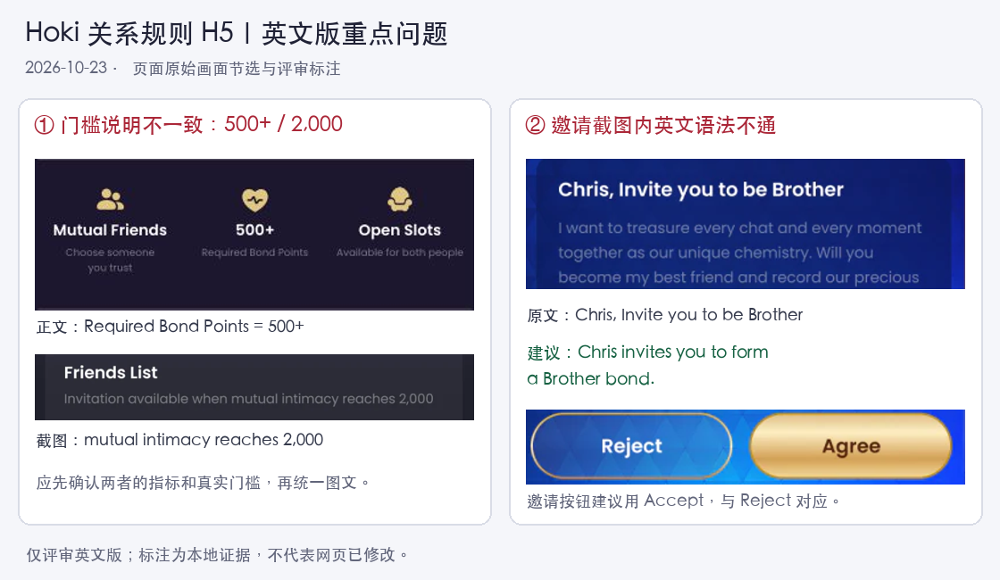

# Hoki｜关系规则 H5｜英文问题清单

- 检查时间：2026-10-23 11:18—11:29（Asia/Shanghai）；报告整理于同日。
- 页面：https://h5-preview.hokilive.net/h5/index.html#/relationship/rules
- 依据：用户指定的预览链接，本轮实际加载的英文页面；未提供正式 PRD、中文源文或语言 key。
- 范围裁决：用户明确“先完成英文版吧”；不包含中文、阿语或 RTL 验收。
- 交付性质：评审意见；未修改或发布网页，任务未归档。

## 1. 正文有 5 处缺空格，可直接修复

以下均核对了可见页面与 DOM 原文，不是截图识别误差。

| 编号 | 位置 | 当前原文片段 | 最小修改 |
|---|---|---|---|
| EN-01 | 01 Choose Your Bond → Brother 描述 | `Openthe mic` | `Open the mic`；更自然的表达是 `Turn on your mic` |
| EN-02 | 02 How to Build a Bond → 步骤 2 | `free slot.Existing bonds` | `free slot. Existing bonds` |
| EN-03 | 03 Grow Your Bond → 引言 | `Bond Pointstogether` | `Bond Points together` |
| EN-04 | 03 → Send something meaningful 描述 | `gifts suchas` | `gifts such as` |
| EN-05 | 03 → Complete bond missions 描述 | `everyshared moment` | `every shared moment` |

Brother 整句可润色为：`Side by side, no explanations needed. Turn on your mic and share everyday moments.`

## 2. 门槛图文不一致，需确认后统一

编号 EN-06。02 节条件区写 `500+ / Required Bond Points`，步骤 2 截图写 `Invitation available when mutual intimacy reaches 2,000`，展示 `Intimacy 2,400 / 2,100`。

图文没有解释 Bond Points 与 Intimacy 是否为同一指标。若是同一邀请门槛，则 500 与 2,000 冲突；若是两种指标，应解释分别如何影响邀请资格。不能仅凭这页决定把哪个数改掉。先确认真实规则，再同步正文、示意图与 App 文案。

证据：[390px 条件与流程](evidence/02-en-390-requirements.jpg)、[邀请列表原图](evidence/step-invite-DXtM4kX_.webp)。

## 3. 邀请示意图里的语法和措辞

编号 EN-07。步骤 3 图片标题是 `Chris, Invite you to be Brother`，逗号、动词形式和关系表达均不自然。建议：`Chris invites you to form a Brother bond.` 正式关系名称若采用其他写法，应同步替换。

图内说明 `Accept to become Brother ; Reject and remain friends.` 也不自然，可改为：`Accept to form a Brother bond, or reject to remain friends.`

按钮当前为 `Reject / Agree`。邀请场景建议 `Reject / Accept`，与图内说明中的 Accept 对齐。Agree 并非拼写错误，这一项属于场景措辞和术语统一建议。

邀请正文 `I want to treasure every chat and every moment together as our unique chemistry.` 表达生硬，可简化为 `Let's cherish every conversation and every moment we share. Will you form a Brother bond with me?` 仅为英文候选，不替代已批准的品牌语气。

证据：[邀请接受原图](evidence/step-accept-BhCtlDyP.webp)。这些文案写在图片内，修改页面多语言文本无法修复图片，需要替换资源。

## 4. 布局与格式

| 编号 | 问题与实测 | 建议 |
|---|---|---|
| UI-01 | 建立条件的小字过小：390px 宽时，`Required Bond Points` 等约 8.32 CSS px；320px 时约 6.83px | 设移动端最小字号；辅助说明建议至少 12px，重要规则建议 14px 左右，通过换行或列数适配 |
| UI-02 | 流程和付费规则偏小：390px 时步骤说明、名额价格说明约 10.40px；320px 时约 8.53px | 关键资格、价格、名额规则不应随屏宽继续缩小 |
| UI-03 | 文字对比偏弱：步骤说明、名额说明等使用 40% 不透明度白色，深紫底上显得暗 | 提高文字亮度及对比度；正式样式按普通文字对比度至少 4.5:1 验证 |
| UI-04 | 图片内信息难读：390px 时步骤图总宽约 315px，接受邀请图的手机界面只占中间一部分，两侧紫色留白占空间 | 裁切操作焦点、放大核心区域，或支持点按看原图；当前未观察到图片放大入口，viewport 也禁止用户缩放 |
| UI-05 | 入口指引不够对应：步骤 1 写打开 `[CP & Friends]`，图内仅见 `Other Intimacy / Add Friend`，没有露出该入口 | 补完整路径截图或箭头标注。两者可能分别是页面名与子区块名，不直接认定其中一个翻译错误 |
| UI-06 | 预览页右下角绿色 `vConsole` 悬浮按钮遮挡内容/图片 | 预览环境可用于调试；面向用户的发布包应隐藏，并按去除调试层后的页面复验 |

正常换行不列为缺陷：390px 时 `Go to Bond Profile → Level Up to see gifts and missions.` 分成两行，但没有截断或越界。320px、390px 全页 DOM 边界扫描未发现主内容横向溢出；已加载的示意图未观察到拉伸变形或加载失败。

## 5. 术语与语义：建议统一或确认

| 编号 | 原文 | 问题与建议 |
|---|---|---|
| COPY-01 | 正文 `Bond Points`；邀请图 `Intimacy`；成长图 `Weekly EXP / Monthly EXP` | 指标命名混用。若同一指标应统一；若不同，应解释区别。不能仅凭名称认定三者一定是同一数值 |
| COPY-02 | 正文 `slots`；解锁图 `EXTRA SEATS`；04 节 `Mic Seat` | 关系名额也称 seats，易与麦位混淆。关系名额建议统一 `Slots`，图内可用 `Extra Slot / Unlock Slot`；麦位保留 `Mic Seat` |
| COPY-03 | `Mutual Friends` | 通常可理解为共同认识的朋友。若实际要求为“互相关注”，建议 `Follow Each Other`，说明 `You follow each other.`；需业务确认 |
| COPY-04 | `Existing bonds and duplicate requests aren't allowed.` | 未说明是与当前邀请对象的关系，可能误读为有任何关系都不能邀请。若限制同一对象，可改为 `You can't send another invitation if you already have a bond or a pending invitation with this person.`，最终以真实状态规则为准 |
| COPY-05 | `Relationship Explanation` | 可以理解，但作为说明页标题生硬。可考虑 `Relationship Guide` 或 `Bond Guide`，属于润色；标题在图片中，若采纳需同步图片和页面标题 |

## 验证与限制

- 实际检查 01—04 四个章节、全部可见正文，并放大检查流程、解锁、升级等已加载图片。
- 在桌面默认视口、390×844 和 320×740 两种手机尺寸检查；保存分段真实截图；临时浏览器尺寸已恢复。
- 核对 DOM 原文、字号、颜色、图片加载和宽高比例、横向溢出；未操作真实邀请、购买或送礼。
- 未提供中文源文、指标定义、已批准规则，因此不声称已确认全部翻译语义或业务数值正确。
- 页面未暴露实际语言 key；本报告的 EN/UI/COPY 编号仅是问题编号，不冒充项目多语言 key。
- 正式 App WebView、系统字体放大、设备亮度及发布包调试入口需回归；浏览器检查不代表真机验收。

## 证据

- [390px 首屏](evidence/01-en-390-top.jpg)
- [390px 条件与前两步](evidence/02-en-390-requirements.jpg)
- [320px 条件与流程](evidence/03-en-320-requirements.jpg)
- [390px 邀请接受与名额说明](evidence/05-en-390-slots.jpg)
- [390px 成长与麦位说明](evidence/06-en-390-growth-mic.jpg)

页面使用内部滚动容器，常规 fullPage 调用未展开全部内容，所以本轮以真实分段截图作为证据，不把单屏截图称为全页截图。
